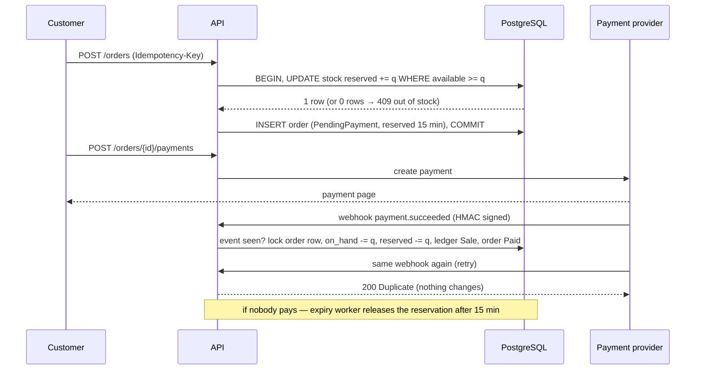

# Stockflow

Online shop backend whose hard problem is **inventory under concurrency**: the last unit is sold exactly once,
abandoned checkouts give their stock back, and a payment notification delivered twice never charges or ships twice.

**.NET 10 · ASP.NET Core · EF Core · PostgreSQL · Redis (HybridCache) · JWT · Docker · xUnit + Testcontainers · OpenTelemetry · k6**

[](https://github.com/DEV3LISS/stockflow/actions/workflows/ci.yml)
· 100 automated tests · 8 decision records · measured performance · documented failure scenarios

## What makes it interesting

| Problem | Solution | Proof |
|---|---|---|
| 100 people buy the last unit at the same millisecond | Atomic `UPDATE … SET reserved = reserved + q WHERE on_hand - reserved >= q` + DB `CHECK` constraints | test: exactly 1 order, 99 × 409 — for each of 3 strategies |
| Flash sale: 300 buyers, 100 units | Same, measured against `SELECT FOR UPDATE` and optimistic locking | k6: all three sell exactly 100, atomic is fastest |
| Stock locked by people who never pay | Reserve only at checkout, 15-minute hold, expiry worker with `FOR UPDATE SKIP LOCKED` | tests incl. 4 parallel workers |
| Payment arrives just as the reservation expires | Both lock the order row; a late payment is flagged `NeedsRefund`, never double-sold | 10-round race test |
| Provider retries / reorders / someone forges webhooks | HMAC signature + timestamp, event-id dedup, terminal payment states | duplicate, out-of-order, forged, replayed tests |
| "Where did these 5 units go?" | Append-only inventory ledger; invariant `on_hand = Σ ledger` checked after every race | invariant assertions |
| Catalog under peak load | Measured first: DB was the bottleneck at 3 000 req/s → HybridCache (memory + Redis) | p95 207 ms → 7.5 ms; Redis down → still works |

## Quick start

```bash
docker compose up --build
```

- Swagger UI: http://localhost:8081/swagger — register a customer (`POST /api/v1/auth/register`) or log in as
  `admin@stockflow.local` / `ChangeMe-2026!` (demo seed).
- Demo catalog includes **"Limited Edition Phone"** with exactly 1 unit — try buying it with two customers.
- Pay without a real provider: `POST /api/v1/orders/{id}/payments`, then
  `POST /simulator/payments/{providerPaymentId}/succeed?deliveries=2` (sends the signed webhook twice).
- Metrics & traces: `docker compose --profile observability up --build` → Prometheus :9091, Jaeger :16687.

## How a purchase flows



## Architecture

Same layered structure as [Torque CRM](https://github.com/DEV3LISS/torque-crm) (Domain / Application / Infrastructure / Api,
enforced by architecture tests). Shop-specific pieces:

- `IStockReservations` — the contended operation, three interchangeable implementations (`Inventory:ReservationStrategy`).
- `PaymentService` — webhook application with exactly-once semantics; `WebhookSignature` (Infrastructure).
- `ExpiryService` + `ExpiryWorker` — background release of unpaid holds.
- `CatalogService` + `HybridCache` — cached public catalog, invalidated by tag.

Details: [requirements](docs/requirements.md) · [decision records](docs/decisions.md) · [performance](docs/performance.md) ·
[failure scenarios](docs/failure-scenarios.md) · [security](docs/security.md)

## API

| Method | Route | Access |
|---|---|---|
| POST | `/api/v1/auth/register`, `/login`, `/refresh`, `/logout` | anonymous (rate-limited) |
| GET | `/api/v1/categories`, `/api/v1/products` (category, search, sort, inStock, paging), `/api/v1/products/{id}` | anonymous (cached) |
| POST / PUT | `/api/v1/categories`, `/api/v1/products`, `/products/{id}/activate`, `/deactivate` | Admin |
| GET / POST | `/api/v1/inventory/{productId}`, `/receipts`, `/adjustments`, `/movements`, `/api/v1/inventory/low-stock` | Admin |
| GET / PUT / DELETE | `/api/v1/cart`, `/api/v1/cart/items` | Customer (own cart only) |
| POST | `/api/v1/orders` (header `Idempotency-Key`) | Customer |
| GET | `/api/v1/orders`, `/api/v1/orders/{id}` | Customer (own) / Admin (all) |
| POST | `/api/v1/orders/{id}/payments`, `/cancel` · `/ship` | Customer · Admin |
| POST | `/webhooks/payments` (header `Stockflow-Signature`) | payment provider |
| POST | `/simulator/payments/{id}/succeed\|fail?deliveries=n` | demo only |
| GET | `/health/live`, `/health/ready`, `/health/status` (Admin), `/metrics` | — |

## Tests

| Project | What | Count |
|---|---|---|
| `Stockflow.UnitTests` | stock rules, cart, order lifecycle, payment states, webhook signature (tamper, replay, malformed), tokens | 38 |
| `Stockflow.IntegrationTests` | real PostgreSQL + Redis (Testcontainers): checkout, **races for 3 strategies**, flash sale, idempotency, webhooks, expiry races, cache invalidation, Redis down, IDOR, auth, OWASP checks | 58 |
| `Stockflow.ArchitectureTests` | layer dependency rules | 2 |
| `Stockflow.E2ETests` | shopper journey against the deployed Docker image | 2 |
| `loadtests/` | k6: catalog under load, flash sale; SQL data generators | — |

```bash
dotnet test                                                              # unit + integration + architecture
STOCKFLOW_E2E_URL=http://localhost:8081 dotnet test tests/Stockflow.E2ETests   # against docker compose
```
